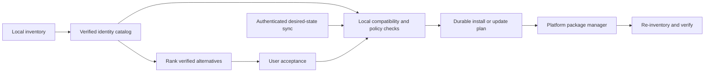

# Kitlane implementation research

Researched 2026-10-11. Proposed architecture, not implemented or security-certified. The current app is a native Rust UI scaffold; the research adds no runtime dependencies.

## Product behavior

Inventory programs already installed on linked devices. Automatically install the same product's compatible version on other devices according to the user's enabled sync policy. Keep managed programs updated. When the same product is unavailable, show its confirmed platform restrictions and offer alternatives for user acceptance.

Inventory coverage, verified identity, platform availability, installability, and update support are separate facts. An app can be detected without having a supported automatic installer. An absent catalog entry does not establish that a product is Windows-only. Display `Unknown`, `Available but manual install required`, `Unsupported on this device`, and confirmed `Windows only` separately.

## Rust scope and recommended stack

All Kitlane application logic, UI, platform adapters, sync service, catalog tools, and AI integration can be written in Rust. Platform APIs, package managers, and third-party installers remain external dependencies with their own implementations. Homebrew is not Rust. If “only Rust” prohibits invoking non-Rust platform tools as well, coverage would shrink substantially and Kitlane would need to take responsibility for more installer behavior. Recommendation: Rust-only Kitlane source, reuse trusted platform installation mechanisms.

| Responsibility | Recommendation | Rationale |
| --- | --- | --- |
| Native UI | Existing egui/eframe | Already builds and launches; keep UI off blocking work |
| Local durable state | redb | Pure Rust embedded database; transactions and crash-safe storage |
| Background I/O | Tokio, selected features | Timers, bounded channels, networking, process supervision |
| HTTP client | reqwest with Rustls TLS | Reuse connections; enforce timeouts and response limits |
| Serialization | serde | Typed network and storage records with explicit validation |
| Sync service | axum | Rust HTTP service; start with one service rather than microservices |
| Windows integration | windows/windows-bindgen | OS calls and WinGet API bindings in a narrow adapter |
| Linux integration | zbus where appropriate | Typed calls to PackageKit's D-Bus interface |
| Credential storage | keyring-core plus explicit OS backend | Select only needed stores; no plaintext token fallback |
| Signed catalog and Kitlane updates | tough / TUF | Established metadata verification instead of a custom updater protocol |

These are candidates to benchmark and audit, not dependencies to add immediately. [redb](https://docs.rs/redb/latest/redb/), [Tokio](https://docs.rs/tokio/latest/tokio/), [reqwest](https://docs.rs/reqwest/latest/reqwest/), [axum](https://docs.rs/axum/latest/axum/), [zbus](https://docs.rs/zbus/latest/zbus/), and [keyring guidance](https://docs.rs/keyring/latest/keyring/) document the relevant capabilities.

## Platform inventory and installation

### Windows

Read per-user and machine uninstall metadata across registry views; include MSIX/AppX inventory through OS APIs. Merge observations without treating every runtime, driver, or update component as a user application. Portable apps need explicit user-added locations or a later bounded discovery feature.

Registry metadata supplies display name, publisher, version, and MSI product identity. Do not use `Win32_Product` for discovery: Microsoft documents that queries may trigger installer consistency checks and repairs. [Registry metadata](https://learn.microsoft.com/en-us/windows/win32/msi/uninstall-registry-key), [Win32_Product warning](https://learn.microsoft.com/de-ch/previous-versions/windows/desktop/msiprov/win32-product).

Prefer WinGet's structured COM/WinRT package catalogs, search, and installation APIs; prototype Rust activation and deployment before committing to that integration. Its IDL exposes local/composite catalog searches, installed-package information, and asynchronous installation. Bindings may need generation from matching Windows metadata; WinGet types are not assumed to be part of the stock Windows SDK bindings. Probe installed API contracts and handle absent/blocked WinGet explicitly. [WinGet API definition](https://raw.githubusercontent.com/microsoft/winget-cli/master/src/Microsoft.Management.Deployment/PackageManager.idl), [Rust metadata binding generator](https://docs.rs/windows-bindgen/latest/windows_bindgen/).

An exact-ID WinGet executable invocation can be a limited fallback, using a verified executable path, fixed argument schema, and explicit source. Avoid parsing localized table output for identity decisions. WinGet can detect applications installed by other means, but that does not make all detected apps automatically manageable. Never bypass installer hash failures or malware checks. [WinGet list](https://learn.microsoft.com/en-ca/windows/package-manager/winget/list), [install controls](https://learn.microsoft.com/en-us/windows/package-manager/winget/install).

### macOS

Read application bundle metadata in standard user/system application locations, with bounded traversal. Capture bundle identifier, release/build version, and verified signing identity when available. Reconcile these with package-manager inventory; a bundle name alone is insufficient. [Apple bundle metadata](https://developer.apple.com/library/archive/documentation/General/Reference/InfoPlistKeyReference/Articles/CoreFoundationKeys.html).

Start automatic installation with a reviewed subset of Homebrew casks, when Homebrew is already present. Read structured metadata and invoke only reviewed cask IDs. Do not automatically bootstrap Homebrew, add taps, or take over every manually installed app. Adoption of existing artifacts needs identity/version checks and explicit policy: Homebrew's `--adopt` requires identical artifacts. Casks can execute installation steps and are part of the trust boundary. Preserve Gatekeeper/quarantine protections; verify vendor signing expectations for supported packages. Kitlane itself needs signing and notarization for distribution. [Homebrew manual](https://docs.brew.sh/Manpage), [Apple notarization](https://developer.apple.com/documentation/security/notarizing-macos-software-before-distribution).

Store-only, paid, login-gated, or interactive installers may require user action. A license on Windows is not evidence of entitlement on macOS.

### Linux

Start with Flatpak applications on devices that already support it. Inventory application ID, origin, architecture, branch, version, and installation scope using explicit machine-readable columns. Use full refs and selected remotes/scopes for install/update, avoiding ambiguous partial IDs. Do not import runtime dependencies into the user's synced app library. A community-packaged build must be labeled honestly; it is not automatically an official vendor release. [Flatpak command reference](https://docs.flatpak.org/en/latest/flatpak-command-reference.html).

Later add distro packages through PackageKit D-Bus, feature-detecting backend capabilities. Treat APT, DNF, and other native systems as distinct adapters when PackageKit cannot provide required behavior. Avoid issuing a blanket system upgrade when the user requested application updates. Preserve dependency resolution and repository signature verification through the manager. [PackageKit transactions](https://packagekit.freedesktop.org/gtk-doc/Transaction.html).

AppImages, source builds, scripts, and custom repositories require explicit additional support. Cross-platform availability also depends on CPU architecture, OS version, distribution/runtime, channel, and license.

## Identity catalog: the central product investment

Create a canonical product ID with reviewed mappings to each source's package ID. Store publisher, vendor domain, edition/channel, platform constraints, package origin, install scope, signing expectations, evidence URL, review date, and update owner.

Prefer stable provider IDs and verified mappings. Never auto-install solely because display names are similar. Distinguish stable/beta, free/pro, forks, community repacks, and helper packages. Treat versions as provider-specific strings; arbitrary application versions are not necessarily SemVer, and the same product can use different versions across OS releases.

Keep catalog review and signing separate from user sync. Changes to publisher, package source, signing identity, or install scope invalidate previously approved plans. A bad reviewed mapping remains a risk even if its catalog signature is valid; signatures protect provenance, not the correctness of the mapping.

Record official counterpart, community build of the same upstream product, and different-product alternative as separate relationships. The default automatic path uses verified official counterparts; community builds need an explicit user policy or acceptance. Similar functionality never establishes same-product identity.

## Local planning and safe execution

Use explicit job states: `Planned -> AwaitingApproval / Ready -> Running -> Verifying -> Succeeded / Failed / NeedsUserAction`. Persist the plan and job state transactionally, keyed by device, product, provider, and operation. Re-inventory after a crash before retrying an installer; third-party installations are not generally safe to replay blindly.

An automatic action requires a verified product mapping, supported target, trusted source, current catalog, user-enabled device policy, eligible license flow, and no local exclusion. User acceptance is always required for a different product suggested by AI. New-device enrollment should show the first sync plan and enable automation intentionally; routine approved sync then runs automatically.

Run the UI and agent without administrator privileges. Use OS package-manager authorization first. Add a small privileged Rust helper only if required; authenticate IPC peers, restrict permissions, and accept typed approved operation IDs rather than arbitrary paths, URLs, or commands. Revalidate the operation at the privileged boundary. Keep business logic under `forbid(unsafe_code)`; isolate and review unavoidable unsafe FFI in a separate platform adapter rather than disabling the rule globally.

Use `Command` with discrete validated arguments and a trusted executable, not shell strings, PowerShell scripts, `cmd /c`, or AI-produced commands. Argument separation does not prevent option injection; validate IDs, executable identity, environment, working directory, and manager-specific semantics. Bound output, duration, downloads, redirects, and retries. Do not kill a running installer casually: interruption may corrupt the installation. [Rust process security details](https://doc.rust-lang.org/stable/std/process/struct.Command.html).

For direct downloads added later, require HTTPS, reviewed origins/redirects, trusted metadata hashes, and appropriate publisher-signature validation. A checksum served alongside a malicious download is insufficient. Protect staging paths against symlinks, archive traversal, replacement races, and writable executable paths. Verify the installed identity/version after completion; exit code alone is not enough. Windows provides Authenticode trust verification through `WinVerifyTrust`. [Windows signature verification](https://learn.microsoft.com/en-us/windows/win32/api/wintrust/nf-wintrust-winverifytrust).

## Sync and privacy

Separate observed inventory from desired sync policy. A device reports facts; another device locally resolves and validates what to install. The server must not send arbitrary executable instructions. Server-side authorization must bind every read/write to account and enrolled device; test tenant isolation, revocation, and replay/stale-revision handling. Use sequence/revision checks, durable outboxes, idempotency keys, and reconnect backoff.

Default proposal: additions can propagate under enabled policy, but deleting an app on one device does not delete it elsewhere. A local removal must not be immediately undone by reconciliation; retain a device-specific exclusion until the user changes it. Keep pins, update preferences, and architecture-specific choices per device.

Use TLS and standard native OAuth/OIDC authorization-code flow with PKCE and an external browser if account login is chosen. Store refresh credentials in the OS credential store; fail safely when secure storage is unavailable. Do not embed service secrets in desktop binaries. Pairing needs short-lived, single-use authorization and revocable device credentials. [Native OAuth guidance](https://www.rfc-editor.org/rfc/rfc8252), [current OAuth security guidance](https://www.rfc-editor.org/rfc/rfc9700).

Sync minimal product/version/policy data. Keep usernames, file paths, documents, license keys, and diagnostic logs local unless explicitly needed. Inventory itself can disclose sensitive interests or employers. State clearly whether the service can read it: TLS and server-side encryption are not end-to-end encryption. If server-blind inventory is required, select an established encrypted sync protocol and obtain security review before implementing it.

## Updates and recovery

Assign one update owner per application: package manager, supported vendor updater, store, or manual. Do not race the vendor updater or switch channels. Use bounded scheduled checks with jitter, pins, deferred restarts, battery/network policy, and package-manager locks. Offline devices reconcile on reconnect.

WinGet documents limitations for unknown installed versions and pinned apps; Homebrew documents special handling for self-updating casks. The planner must reflect those capabilities rather than applying generic version comparisons or indiscriminate upgrade-all. [WinGet upgrade](https://learn.microsoft.com/en-us/windows/package-manager/winget/upgrade), [Homebrew self-updates](https://docs.brew.sh/FAQ).

Keep an audit record of source, old/new version, verification evidence, outcome, and restart requirement. Retry only after checking actual state. Support rollback where a provider offers it; do not promise universal rollback or assume reinstalling an older binary restores changed user data.

For Kitlane's own binary and curated catalog, evaluate TUF with tough: authenticated metadata, trusted root, hashes, expiry, and version checks address update/replay risks. Test key rotation and offline expiry behavior. This protects Kitlane-controlled distribution, not arbitrary third-party installers; those retain their provider trust model. [TUF specification](https://theupdateframework.github.io/specification/v1.0.36/), [tough Rust client](https://github.com/awslabs/tough).

## AI alternatives

Retrieve candidates from the verified catalog, then rank feature similarity, workflow fit, file interoperability, and preference match. Code filters unsupported targets and computes exact constraints. Display source-backed advantages, missing capabilities, price provenance, and packaging origin; avoid an unqualified “better.” Unknown or weak evidence should produce no recommendation.

TypeSafe Jev is a candidate for typed pairwise judgments and ranking. Its HTTP API can be called from Rust using reqwest and serde; Python or JavaScript SDKs are not required. Its entity-alignment cookbook is relevant to catalog curation, and composite scoring supports separate ranking dimensions. Evaluate it on representative software pairs before choosing it. Confidence is not proof of identity, compatibility, or installation authorization. Jev is not a prose-generation model: assemble explanations from catalog facts and scored rubrics, or evaluate a separate explanation service later. [HTTP API](https://docs.typesafe.ai/api), [entity alignment](https://docs.typesafe.ai/cookbooks/entity_alignment), [composite scoring](https://docs.typesafe.ai/patterns/composite-scoring), [confidence](https://docs.typesafe.ai/confidence).

Keep provider credentials on the Rust backend. Send only candidate facts needed for that recommendation; do not upload the entire software inventory to an AI provider by default. Treat vendor descriptions and model output as untrusted data. Validate returned IDs against the supplied shortlist; model output never determines an installer URL, package source, privilege, or shell command. AI failure must not block exact verified sync.

## Efficient implementation and delivery sequence

Keep initial code in modules inside app/; split Cargo crates only when isolation or reuse warrants it. The eventual service and privileged adapter are meaningful separate boundaries. One agent can share a single runtime; use bounded queues/concurrency, reuse HTTP connections, cache catalog revisions, sync deltas, and repaint only on state changes. Background updates need an agent or OS scheduler when the UI is closed; closing the window cannot silently disable a promised update service.

Measure release-mode startup, visible/hidden/agent working set, idle CPU and wakeups, scan latency, matching latency, sync bytes, and installer concurrency on real Windows/macOS/Linux hardware. The current Windows UI measurement was 5.98 MiB executable and about 127 MiB startup working set; it is not an optimized background-agent budget. A local large AI model is a poor default for a low-resource agent.

1. Implement read-only Windows inventory, durable storage, and a small reviewed catalog. Separate visible apps from dependencies and distinguish verified/unknown identities.
2. Add macOS and Linux read-only adapters plus a compatibility matrix. Validate matching using collected representative fixtures and vendor evidence.
3. Prove exact-ID installations in disposable test machines for each provider. Add authorization, plan revalidation, crash recovery, and post-install verification.
4. Add authenticated device enrollment and sync; test duplicate, reordered, stale, revoked-device, and cross-account requests.
5. Enable automatic installation/update only for the tested provider/product subset. Expand coverage based on observed failure modes.
6. Add AI alternatives with labeled software comparisons and source-backed explanations. Acceptance creates a normal validated install plan.

Required failure tests include similarly named products, forks/editions, wrong architecture, missing installer, missing manager, hash mismatch, signer mismatch, expired metadata, offline devices, untrusted description text, malformed AI responses, elevation denial, disk exhaustion, installer locks, interrupted installs, downgrade avoidance, uninstall exclusions, and update-owner conflicts. Run native integration tests on all supported OSes; a Windows build does not verify macOS/Linux behavior. Audit Cargo.lock with RustSec/cargo-deny, including transitive dependencies and source/license policy. [RustSec](https://rustsec.org/), [cargo-deny](https://embarkstudios.github.io/cargo-deny/checks/advisories/cfg.html).

## Decisions before implementation

Confirm supported Windows/macOS versions and Linux distributions; whether Homebrew/Flatpak are acceptable prerequisites; which device/app policies enable automation; cloud-readable versus encrypted inventory; and update behavior for paid/store/interactive apps. Rust and verified sources reduce risks, but cannot make unknown installers harmless or guarantee every installed program has a supported update path.
